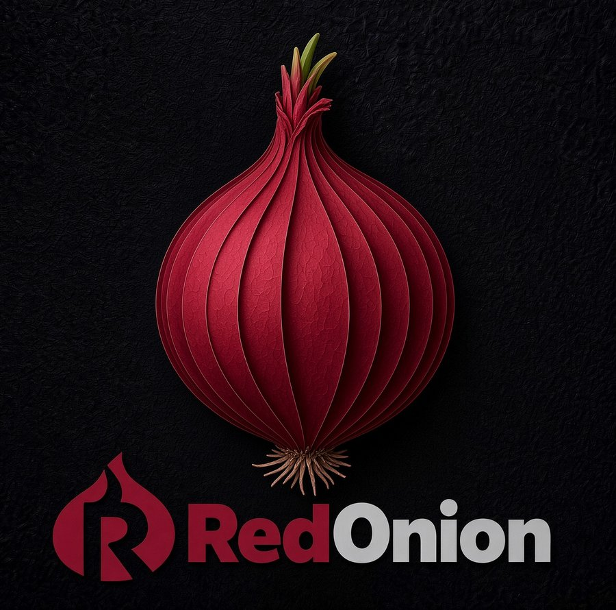

<h1 align="center">RedOnion</h1>

<h3 align="center">Like Onion but faster, safer and smarter - with more features and cores!</h3>

<b>Supported devices: Miyoo Mini, Mini v4, Mini Plus and Mini Flip</b>

RedOnion (formerly OnionPlus) is an independent build of [Onion](https://github.com/OnionUI/Onion) for the Miyoo Mini family. Same menus, same themes, same emulators, same folders: everything you know from Onion is still there, with fixes, improvements and new features on top.

<h2 align="center">Why RedOnion?</h2>

Onion is one of the best things that ever happened to the Miyoo Mini, and RedOnion is built on it. RedOnion isn't here to replace Onion, but to add to it: it **fixes** the bugs that are still there, **improves** what already works (speed, reliability, battery life) and **adds** new features and cores. It keeps Onion's layout, so your games, saves and themes carry over, and it keeps moving: bugs get fixed quickly and new features keep coming.

RedOnion started as my personal build to test fixes on real devices, and has become a build others can use too. Every change stays public, so the Onion team can take anything they want from it if they wish to continue the original project.

<h2 align="center">Why make the switch?</h2>

- 🐞 **Quick fixes.** Bug reports are looked at and fixed ASAP, and feature requests and pull requests are welcome: if they are feasible, they get in.
- ⚡ **A faster everyday.** Game launches, menus, sleep, volume and the GameSwitcher were all rebuilt for speed, and the launcher idles at a fraction of the CPU.
- 🆕 **Open MainUI.** An open-source launcher by [@robcodedev](https://github.com/robcodedev/onionos-mainui-opensource) replaces Miyoo's closed one, at about 400 KB instead of 1.4 MB: consoles as a carousel, a grid or a list, video previews in the game lists, a Game Info menu with box art, screenshots, game maps, walkthroughs and PDF manuals, Saved Games with a picture of every save state, scrolling titles and letter jump. The stock MainUI stays on the card, one file away.
- 🛡️ **Fixes for issues still present in Onion.** Dozens of bugs fixed in the shared code: crashes, memory leaks, lost settings, a wrong clock, play history that could be deleted.
- 🔌 **Settings that survive a power cut.** Settings, key map, recents and play history are written safely, even if the battery dies mid-save.
- 🎨 **Your layout, your buttons.** A footer with the hints in button order (B then A) that the whole system follows, X and Y shortcuts for a game's options or Favorites, and SELECT menu labels that fit in every language.
- 🕹️ **A GameSwitcher that knows big games.** Pictures, Save and Load work for Neo Geo, arcade, PS1 and large GBA games, and no more crash in Game & Watch and 11 other cores.
- 🔋 **Longer battery with Wi-Fi.** Wi-Fi power saving is on by default, and turns off by itself during netplay and while a file-transfer service (FTP, SSH, Samba, the web file manager) is on, so those stay fast.
- 🎮 **Mini Flip support** ported from Onion's development branch, with lid and suspend fixes.
- 📡 **Updates over Wi-Fi.** A stable channel for everyone and a beta channel for early testers, straight from the device.
- 🧪 **Tested on every change.** More than 1,600 automated tests run on each update before it ships.

<h2 align="center">Switching from Onion</h2>

Your games, saves and BIOS files carry over. RedOnion keeps Onion's file layout.

1. Back up your SD card, at least `Roms`, `Saves`, `BIOS` and `Screenshots`.
2. Download the latest release from the [Releases page](https://github.com/Amiga500/Onion/releases).
3. For the cleanest start, format the card, copy the release onto it, then copy back `Roms`, `Saves`, `BIOS` and `Screenshots`.
4. Insert the card and power on. Later updates arrive through the OTA app.

<h2 align="center">Disclaimer</h2>

- **Use at your own risk.** RedOnion is provided "as is", without any warranty, as stated in sections 15 and 16 of the [GPL-3.0 license](LICENSE). The authors and contributors are not responsible for any damage to your device, SD card, battery or data, or for any other loss, however it happens.
- **Overclocking, undervolting and similar settings** (CPU clock changes, LCD undervolt, display or power tweaks, custom cores and scripts) run the hardware outside its default limits. They can cause instability, data corruption, overheating, faster battery wear or permanent damage. If you change them, you do so entirely at your own risk.
- **Always back up your SD card** before installing or updating, at least `Roms`, `Saves`, `BIOS` and `Screenshots`. An update, a power cut or a faulty card can lose data.
- **No games or BIOS files are included.** You are responsible for the content you put on your device and for following the laws of your country.
- **Not an official Onion release.** RedOnion is not affiliated with the Onion team, with Miyoo, or with the authors of the emulators and apps it includes. Onion's [documentation](https://onionui.github.io/docs) still describes how everything works.
- **Found a bug?** [Open an issue](https://github.com/Amiga500/Onion/issues) with your model, version and steps to reproduce.
- **Want the details?** The [technical reference](docs/TECHNICAL.md) lists every change, measurement and test.

<h2 align="center">Thanks</h2>

- **The Discord team:** [@robcodedev](https://github.com/robcodedev) for Open MainUI, zazzagone, Veuks and lordelan.
- **[@dredvm](https://github.com/dredvm)** for the RedOnion logo, the Silky RedOnion theme and the name of the project.
- **[KyleBing](https://github.com/KyleBing/retro-game-console-icons)** for the Retro game console icons, the console pictures of the carousel and the list (CC BY 4.0).
- **The [Onion team](https://github.com/OnionUI/Onion):** without their work this project would never have been born. The menus, emulators, themes and almost all of the code are theirs.
- **The whole community:** everyone who supports this project, reports bugs, opens pull requests and tests RedOnion in depth.
